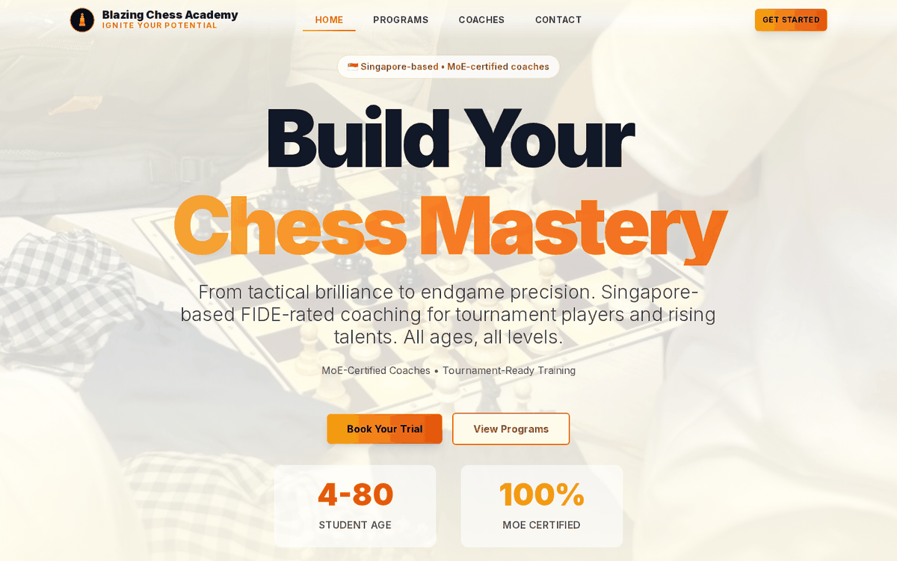

# Blazing Chess Academy 🔥♟️ 

Website for Blazing Chess Academy, a Singapore chess coaching academy, built with Next.js 14, TypeScript, Tailwind CSS and shadcn/ui, with a validated registration form.

[](https://nextjs.org/)
[](https://www.typescriptlang.org/)
[](https://tailwindcss.com/)
[](https://blazing-chess.vercel.app)



**Ignite Your Potential**

A modern, beautiful chess academy website built with Next.js 14, featuring dark mode aesthetics with Black/Gold/Fire Orange branding.

## 🎨 Brand Identity

- **Name:** Blazing Chess Academy
- **Tagline:** Ignite your potential
- **Founder:** Unknown Blaze - Competitive Strategist
- **Colors:** Black / Gold / Fire Orange
- **Theme:** Dark-mode first design

## 🚀 Tech Stack

- **Framework:** Next.js 14 (App Router)
- **Language:** TypeScript
- **Styling:** Tailwind CSS + Shadcn/UI
- **Forms:** React Hook Form + Zod validation
- **Database:** Supabase (calls mocked for now)

## 📁 Project Structure

```
src/
├── app/                    # Next.js 14 App Router
│   ├── layout.tsx          # Root layout
│   ├── page.tsx            # Landing page
│   └── globals.css         # Global styles
├── components/             # React components
│   ├── ui/                 # Shadcn/UI components
│   └── registration-modal.tsx
├── lib/                    # Utilities & config
│   ├── types.ts            # TypeScript interfaces
│   ├── validations.ts      # Zod schemas
│   ├── utils.ts            # Utility functions
│   └── constants.ts        # App constants
└── hooks/                  # Custom React hooks
```

## 🎯 Features

### Landing Page (app/page.tsx)

✅ **Hero Section**
- Headline: "Master the Board, Ignite the Mind"
- Subtle dark chess pattern background
- Call-to-Action: "Join the Academy"
- Stats showcase (500+ students, 50+ tournaments, 15+ years)

✅ **About Section**
- Founder bio featuring Unknown Blaze
- Professional credentials display
- Brand story and mission

✅ **Offerings Grid**
Three program cards:
1. **School CCA Coaching** - Group training for schools
2. **Private Mentorship** - One-on-one elite coaching
3. **Online Blitz Tournaments** - Fast-paced competitions

### Registration Modal (components/registration-modal.tsx)

✅ **Beautiful Dark-Themed Dialog**
- Shadcn/UI Dialog component
- Smooth animations and hover effects
- Amber/Orange gradient CTAs

✅ **Form Fields with Validation**
- Parent Name (required, 2-100 chars)
- Student Name (required, 2-100 chars)
- Current Elo (optional, 100-3000)
- School (required, 2-200 chars)
- Contact Number (required, SG format: 8 digits)
- Additional Message (optional, max 500 chars)

✅ **Singapore Phone Validation**
- Must be 8 digits
- Must start with 3, 6, 8, or 9
- Real-time validation feedback

### Type Definitions (lib/types.ts)

✅ **Core Interfaces**
```typescript
- Student
- Course (with CourseType & CourseLevel enums)
- RegistrationRequest
- RegistrationResponse
- OfferingCard
- Tournament
```

## 🎨 Design System

### Colors (Tailwind Config)
- **Primary:** Amber-500 (#F59E0B)
- **Accent:** Orange-600 (#EA580C)
- **Background:** Black (#000000)
- **Cards:** Gray-900/950 gradients
- **Text:** White with gray variants

### Typography
- **Font:** Inter (Google Fonts)
- **Hero:** 5xl - 8xl responsive
- **Headings:** 2xl - 5xl with gradients
- **Body:** Base to xl

### Components Style Guide
- **Buttons:** Gradient backgrounds with glow effects
- **Cards:** Border glow on hover with lift animation
- **Inputs:** Dark background with amber focus rings
- **Modals:** Full-screen overlay with centered content

## 🛠️ Setup Instructions

### Prerequisites
- Node.js 18+ 
- npm/pnpm/yarn

### Installation

1. **Install Dependencies**
```bash
npm install
```

2. **Run Development Server**
```bash
npm run dev
```

3. **Open Browser**
Navigate to [http://localhost:3000](http://localhost:3000)

### Building for Production

```bash
npm run build
npm start
```

## 📦 Required Shadcn/UI Components

The following Shadcn/UI components need to be installed:

```bash
npx shadcn-ui@latest add button
npx shadcn-ui@latest add dialog
npx shadcn-ui@latest add input
npx shadcn-ui@latest add label
npx shadcn-ui@latest add card
npx shadcn-ui@latest add textarea
```

## 🔌 Database Integration (Future)

Currently, the registration form uses **mocked API calls**. To connect to Supabase:

1. Create a Supabase project
2. Add environment variables:
```env
NEXT_PUBLIC_SUPABASE_URL=your_url
NEXT_PUBLIC_SUPABASE_ANON_KEY=your_key
```
3. Implement Supabase client in `lib/supabase/client.ts`
4. Replace mock calls in registration modal

## 🎓 Course Types

- **School CCA** - Group coaching for schools
- **Private Mentorship** - 1-on-1 elite training
- **Online Blitz** - Fast-paced tournaments
- **Group Lessons** - Small group sessions

## 📱 Responsive Design

- **Mobile-first** approach
- Breakpoints: sm (640px), md (768px), lg (1024px)
- Optimized touch targets for mobile
- Responsive typography and spacing

## ♿ Accessibility

- Semantic HTML structure
- ARIA labels where needed
- Keyboard navigation support
- Focus visible states
- High contrast color scheme

## 🚧 Roadmap

- [ ] Complete Supabase integration
- [ ] Add authentication system
- [ ] Build admin dashboard
- [ ] Implement payment gateway
- [ ] Create student portal
- [ ] Add course management system
- [ ] Build tournament platform
- [ ] Email notifications
- [ ] Analytics integration

## 📄 License

Private - Blazing Chess Academy

## 🤝 Contributing

This is a private project. For inquiries, contact the development team.

---

**Built with 🔥 by Blazing Chess Academy Development Team**

*Master the Board, Ignite the Mind* ♟️✨
