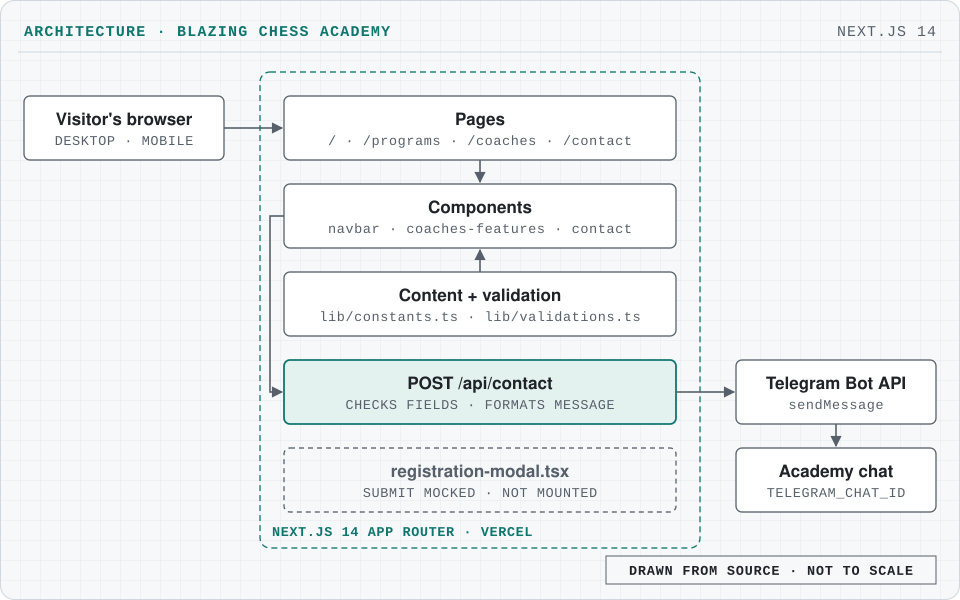

# Blazing Chess Academy 🔥♟️ 

Website for Blazing Chess Academy, a Singapore chess coaching academy, built with Next.js 14, TypeScript, Tailwind CSS and shadcn/ui, with a validated registration form.

[](https://nextjs.org/)
[](https://www.typescriptlang.org/)
[](https://tailwindcss.com/)
[](https://blazing-chess.vercel.app)


**Ignite Your Potential**

A modern, beautiful chess academy website built with Next.js 14, featuring dark mode aesthetics with Black/Gold/Fire Orange branding.

## What it does

The site presents the academy, its coaches and its programmes, and takes inquiries. A parent fills in the contact form; the site checks the fields and forwards the inquiry to the academy's Telegram chat.

### Brand identity

- **Name:** Blazing Chess Academy
- **Tagline:** Ignite your potential
- **Founder:** Unknown Blaze - Competitive Strategist
- **Colors:** Black / Gold / Fire Orange
- **Theme:** Dark-mode first design

### Features

#### Landing Page (app/page.tsx)

✅ **Hero Section**
- Headline: "Master the Board, Ignite the Mind"
- Subtle dark chess pattern background
- Call-to-Action: "Join the Academy"
- Stats showcase (500+ students, 50+ tournaments, 15+ years)

✅ **About Section**
- Founder bio featuring Unknown Blaze
- Professional credentials display
- Brand story and mission

✅ **Offerings Grid**
Three program cards:
1. **School CCA Coaching** - Group training for schools
2. **Private Mentorship** - One-on-one elite coaching
3. **Online Blitz Tournaments** - Fast-paced competitions

#### Registration Modal (components/registration-modal.tsx)

✅ **Beautiful Dark-Themed Dialog**
- Shadcn/UI Dialog component
- Smooth animations and hover effects
- Amber/Orange gradient CTAs

✅ **Form Fields with Validation**
- Parent Name (required, 2-100 chars)
- Student Name (required, 2-100 chars)
- Current Elo (optional, 100-3000)
- School (required, 2-200 chars)
- Contact Number (required, SG format: 8 digits)
- Additional Message (optional, max 500 chars)

✅ **Singapore Phone Validation**
- Must be 8 digits
- Must start with 3, 6, 8, or 9
- Real-time validation feedback

#### Type Definitions (lib/types.ts)

✅ **Core Interfaces**
```typescript
- Student
- Course (with CourseType & CourseLevel enums)
- RegistrationRequest
- RegistrationResponse
- OfferingCard
- Tournament
```

> The registration modal is built but not mounted on any page yet; its submit is mocked. Live inquiries go through the contact form described under Architecture.

### Course types

- **School CCA** - Group coaching for schools
- **Private Mentorship** - 1-on-1 elite training
- **Online Blitz** - Fast-paced tournaments
- **Group Lessons** - Small group sessions

## Architecture

<picture>
  <source media="(prefers-color-scheme: dark)" srcset="docs/architecture-dark.svg">
  
</picture>

- **Pages** ([src/app](src/app)). Four App Router routes: `/` (landing), `/programs`, `/coaches` and `/contact`, deployed on Vercel.
- **Components** ([src/components](src/components)). Navbar, coaches features and the contact section, built from shadcn/ui primitives in `src/components/ui`.
- **Content** ([src/lib/constants.ts](src/lib/constants.ts)). Brand, offerings and pricing live in one file; [src/lib/validations.ts](src/lib/validations.ts) holds the Zod schemas.
- **Inquiries** ([src/app/api/contact/route.ts](src/app/api/contact/route.ts)). The contact form posts JSON to `POST /api/contact`. The route handler checks the required fields and the Telegram settings, formats the message and calls the Telegram Bot API `sendMessage` for the chat in `TELEGRAM_CHAT_ID`.
- **No database yet.** Nothing is stored server-side; Supabase is planned (see Roadmap).

## Tech stack

| Area | Tools |
|---|---|
| Framework | Next.js 14 (App Router) |
| Language | TypeScript |
| Styling | Tailwind CSS + shadcn/ui (Radix UI), lucide-react icons |
| Forms | React Hook Form + Zod validation |
| Inquiries | Next.js route handler → Telegram Bot API |
| Database | Supabase (calls mocked for now) |
| Hosting and CI | Vercel; GitHub Actions runs typecheck, lint and build |

## Getting started

### Prerequisites

- Node.js 18+ (CI uses Node 20)
- npm/pnpm/yarn

### Installation

1. **Install Dependencies**
```bash
npm install
```

2. **Set environment variables** (for the contact form). Copy [.env.example](.env.example) to `.env.local` and fill in:

| Variable | Used by |
|---|---|
| `TELEGRAM_BOT_TOKEN` | `src/app/api/contact/route.ts`: bot that sends the inquiry |
| `TELEGRAM_CHAT_ID` | `src/app/api/contact/route.ts`: chat that receives it |

`.env.example` also lists `NEXT_PUBLIC_SUPABASE_URL`, `NEXT_PUBLIC_SUPABASE_ANON_KEY` and `SMTP_*` for planned features; the current code does not read them. Without the Telegram variables the site runs, and the contact route answers with a configuration error.

3. **Run Development Server**
```bash
npm run dev
```

4. **Open Browser**
Navigate to [http://localhost:3000](http://localhost:3000)

### Building for production

```bash
npm run build
npm start
```

`npm run lint` runs ESLint. More detail is in [SETUP.md](SETUP.md); design specifications are in [DESIGN.md](DESIGN.md).

### Shadcn/UI components

The following Shadcn/UI components are used. They are already committed under `src/components/ui`; these commands are only needed to regenerate them:

```bash
npx shadcn-ui@latest add button
npx shadcn-ui@latest add dialog
npx shadcn-ui@latest add input
npx shadcn-ui@latest add label
npx shadcn-ui@latest add card
npx shadcn-ui@latest add textarea
```

### Database integration (future)

Currently, the registration form uses **mocked API calls**. To connect to Supabase:

1. Create a Supabase project
2. Add environment variables `NEXT_PUBLIC_SUPABASE_URL` and `NEXT_PUBLIC_SUPABASE_ANON_KEY`
3. Implement Supabase client in `lib/supabase/client.ts`
4. Replace mock calls in registration modal

## Project structure

```text
src/
├── app/                        # Next.js 14 App Router
│   ├── layout.tsx              # Root layout
│   ├── page.tsx                # Landing page
│   ├── programs/page.tsx       # Programmes
│   ├── coaches/page.tsx        # Coaches
│   ├── contact/page.tsx        # Contact
│   ├── api/contact/route.ts    # Contact form → Telegram
│   └── globals.css             # Global styles
├── components/                 # React components
│   ├── ui/                     # Shadcn/UI components
│   ├── navbar.tsx
│   ├── coaches-features.tsx
│   ├── contact-section.tsx
│   └── registration-modal.tsx  # Not mounted yet
└── lib/                        # Utilities & config
    ├── types.ts                # TypeScript interfaces
    ├── validations.ts          # Zod schemas
    ├── utils.ts                # Utility functions
    └── constants.ts            # App constants
public/                         # Photos and icon
docs/                           # README images
```

## Design system

### Colors (Tailwind Config)
- **Primary:** Amber-500 (#F59E0B)
- **Accent:** Orange-600 (#EA580C)
- **Background:** Black (#000000)
- **Cards:** Gray-900/950 gradients
- **Text:** White with gray variants

### Typography
- **Font:** Inter (Google Fonts)
- **Hero:** 5xl - 8xl responsive
- **Headings:** 2xl - 5xl with gradients
- **Body:** Base to xl

### Components Style Guide
- **Buttons:** Gradient backgrounds with glow effects
- **Cards:** Border glow on hover with lift animation
- **Inputs:** Dark background with amber focus rings
- **Modals:** Full-screen overlay with centered content

### Responsive design

- **Mobile-first** approach
- Breakpoints: sm (640px), md (768px), lg (1024px)
- Optimized touch targets for mobile
- Responsive typography and spacing

### Accessibility

- Semantic HTML structure
- ARIA labels where needed
- Keyboard navigation support
- Focus visible states
- High contrast color scheme

## Screenshots

The landing page is shown at the top of this README; the live site is at [blazing-chess.vercel.app](https://blazing-chess.vercel.app).

## Roadmap

- [ ] Complete Supabase integration
- [ ] Add authentication system
- [ ] Build admin dashboard
- [ ] Implement payment gateway
- [ ] Create student portal
- [ ] Add course management system
- [ ] Build tournament platform
- [ ] Email notifications
- [ ] Analytics integration

## Contributing

For inquiries, contact the development team.

## Credits

**Built with 🔥 by Blazing Chess Academy Development Team**

*Master the Board, Ignite the Mind* ♟️✨

## Licence

[MIT](LICENSE) © 2026 Rudra Prasadh Ganesh
